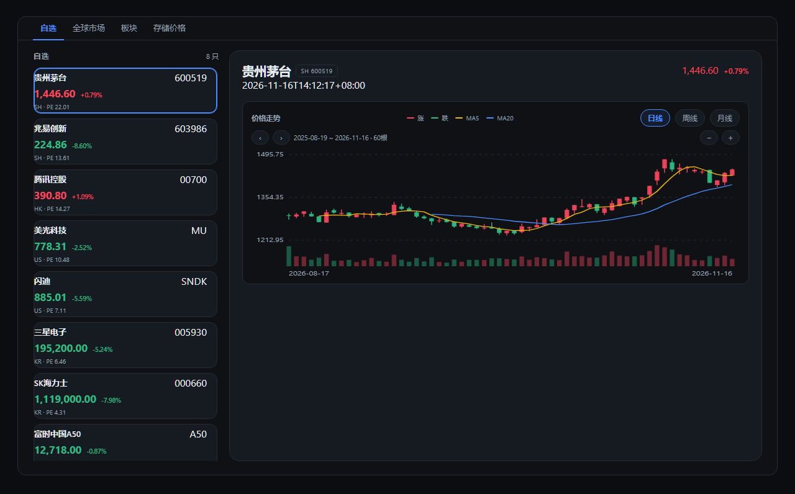
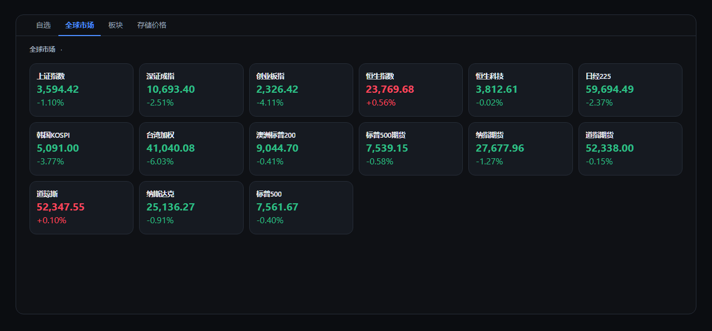
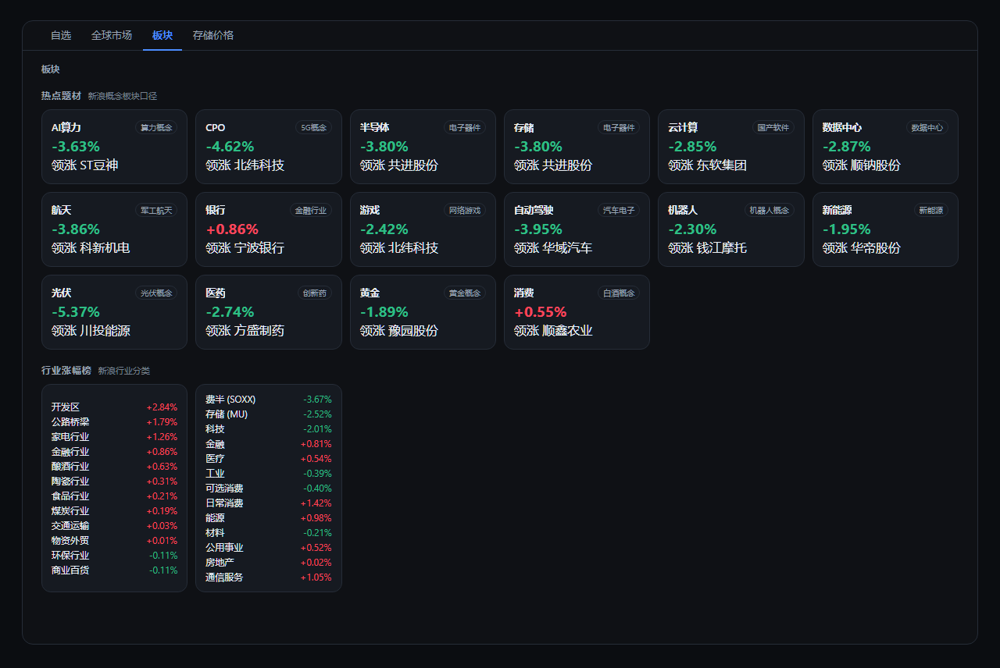
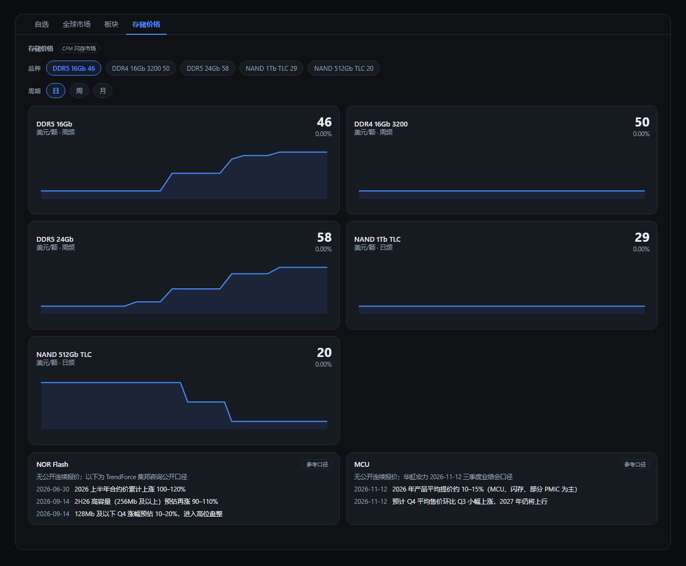

# 盯盘 · dsh-dingpan

> DeepSeek Harness 的行情盯盘插件：自选实时报价、日/周/月 K 线、全球市场、板块与存储价格，外加一个常驻任务栏的价格胶囊。

[](https://www.npmjs.com/package/dsh-dingpan)
[](./LICENSE)
[-blue.svg)](#任务栏挂件)

> [!IMPORTANT]
> **暗盘页签需要开启代理（VPN / 系统代理）才能取到 OKX、Bitget 的报价。**
> 这两家的域名在国内网络直连被拦（`www.okx.com` 解析到不可路由地址、`api.bitget.com` 连接被重置）；不开代理时插件会自动回落到可直连的 Gate（`gateio.ws`），此时只有 Gate 那一家的价格和 K 线，人民币汇率也会用上一次的缓存值。其余页签（自选 / 全球市场 / 板块 / 存储价格）走 Host 侧国内数据源，不需要代理。

## 截图

| 自选 + K 线 | 全球市场 |
| --- | --- |
|  |  |

| 板块（题材 / 行业 / 美股） | 存储价格（DRAM / NAND） |
| --- | --- |
|  |  |

任务栏胶囊：


## 功能

- **自选行情**：A 股 / ETF / 指数、港股、美股、韩股、富时中国 A50 可以混在同一份自选里；卡片显示现价、涨跌幅、换手率（港美股显示成交量）、市盈率与迷你走势，美股另有盘前/盘后一行。
- **暗盘**：加密交易所上架的股票永续（如闪迪 `SNDKUSDT`），OKX / Bitget / Gate 三处自动找流动性最好的那个交易对；24 小时连续报价，15 分钟 / 1 小时 / 日线三档 K 线，刷新频率可选 5 秒 / 10 秒 / 30 秒 / 1 分钟，一键暂停自动获取，并支持人民币换算和对 A 股折溢价。**需要开启代理才能取到 OKX / Bitget，详见顶部提示。**
- **K 线**：红涨绿跌 + MA5/MA20 + 成交量；`日线 / 周线 / 月线` 切换，`‹ ›` 翻页、`−/+` 缩放（15–240 根），窗口区间与根数实时显示。
- **量化研判**：趋势结构、MA5/10/20/60、RSI(14)、MACD、ATR(14)、20 日年化波动率、20/60 日涨跌、量比，以及上行突破 / 下行跌破的情景条件与支撑压力位。
- **全球市场**：亚太（上证、深证、创业板、恒生、恒生科技、日经 225、韩国 KOSPI、台湾加权、澳洲 200）与美股（标普/纳指/道指期货 + 三大现金指数），每个品种带交易时段标签（交易中 / 午休 / 已收盘）。
- **板块**：16 个热点题材、行业涨幅榜、美股 11 个 GICS 板块（SPDR ETF 代理，费半用 SOXX、存储用 MU 并标注）。
- **存储价格**：DDR5 / DDR4 / NAND 现货走势，日/周/月切换；NOR Flash 与 MCU 没有公开连续报价，单独给「参考口径」卡片并标注来源与日期。
- **任务栏胶囊**：把自选里的一只股票钉在任务栏右侧，显示名称、价格、涨跌幅与序号；`‹ ›` 切换上一只/下一只，配色跟随任务栏明暗，可拖动。
- 中文 / English 双语，跟随 DSH 当前语言；自选保存在浏览器 `localStorage`（最多 20 只）。

## 安装

```bash
npm install dsh-dingpan
```

在 DSH 里启用（或用本地目录直接安装）：

```text
plugin_manager install_bundle target=<目录或包名>
```

刷新页面，点左侧栏「盯盘」。

> 任务栏胶囊需要一个可用的 Python（Pillow）。Host 会依次尝试 `%USERPROFILE%\.dsh\dsh-runtimes\*\dependencies\python\pythonw.exe` 与系统 `PATH`；找不到时胶囊按钮会提示，其它功能不受影响。

## 支持的代码写法

| 市场 | 写法 |
| --- | --- |
| A 股 / ETF / 指数 | `600519`、`SH600519`、`600519.SH`、`000001.SZ`、`920001`（北交所）、`SH000001` |
| 港股 | `00700`、`HK00700`、`00700.HK` |
| 美股 | `MU`、`US.MU`、`MU.US` |
| 韩股 | `KS005930`、`005930.KS`（三星电子、SK 海力士） |
| 富时中国 A50 | `A50`、`CN00Y`、`FTSEA50`、`A50QH` |
| 暗盘（股票永续） | `SNDKUSDT`、`SNDK`、`SNDK-USDT`、`SNDK-USDT-SWAP` |

可一次粘贴多个代码，用逗号、空格或中文逗号分隔。

## 数据源

| 用途 | 主源 | 兜底 |
| --- | --- | --- |
| A 股 / ETF / 指数行情 | 腾讯 `qt.gtimg.cn` | 东财 `ulist.np` |
| 港股行情 | 腾讯 `ifzq` 分时快照 | 东财 |
| 韩股行情 | 东财 `177.*` | 腾讯 `kr005930` |
| 美股行情 | CNBC `restQuote`（含盘前/盘后） | — |
| 日 / 周 / 月 K 线 | 腾讯 `fqkline`（港 `hkfqkline`）/ 东财 `klt=101/102/103` | 韩股回退 Naver `fchart` |
| 全球市场 | 东财 `ulist.np` + `clist` | 腾讯（沪深创、恒指、恒生科技、美股三大指数、标普期货） |
| 板块题材 / 行业 | 新浪（概念 + 行业全表） | 东财（仅新浪没有的算力/CPO/存储/数据中心等新概念） |
| 存储价格 | CFM 闪存市场公开报价 | — |
| 暗盘（股票永续） | OKX `SNDK-USDT-SWAP` | Bitget `SNDKUSDT`、Gate `SNDK_USDT`、OKX 现货 |

所有请求都在 Host 侧完成（`ctx.web`），浏览器不直连行情域名；每个路由带 TTL 缓存，页面「刷新」用 `?fresh=1` 绕过缓存。

> 暗盘页签是唯一的例外：它的行情由浏览器直接请求交易所公共 REST 接口，因此走的是本机系统代理（Host 的 Node 进程不读 Windows 代理设置）。接口均返回 `Access-Control-Allow-Origin`，页面直连不需要额外开 CORS。

## 页面说明

### 全球市场页签

指数与美股现金指数取东财 `ulist.np`（secid 形如 `1.000001`、`100.N225`、`124.HSTECH`）；美股三大期货取 `103.ES00Y` / `103.NQ00Y` / `103.YM00Y`（CME 当月连续）。东财漏返回或不可用时，回退腾讯 `usDJI` / `usIXIC` / `usINX` / `hkHSI` / `hf_ES`，再用东财分市场列表补日韩台澳。

### 板块页签

- 题材与行业主数据源是新浪：`newSinaHy.php`（行业）与 `newFLJK.php?param=class`（概念），一次拉全表后本地按别名映射，不再依赖东财板块接口。
- 新浪没有算力 / CPO / 存储芯片 / 数据中心这类新概念，这几个题材仍走东财；东财不可用时仅这几行显示 `—`。
- 映射示例：银行→金融行业、半导体→电子器件、存储→电子器件、云计算→国产软件、航天→军工航天、机器人→机器人概念、光伏→光伏概念、医药→创新药、黄金→黄金概念、消费→白酒概念、自动驾驶→汽车电子、CPO→5G概念（近似）。
- 费半用 `SOXX` 代理（东财没有费城半导体指数），存储周期额外给一行 `MU`。

### 存储价格页签

- 数据源 CFM 闪存市场公开报价页，10 分钟缓存、可强制刷新。
- DDR5 16Gb / DDR4 16Gb / DDR5 24Gb 为**周频**（每周二 11:00 更新）；NAND 1Tb / 512Gb TLC 为**日频**（每天三次报价）。
- CFM 的图表 JSON 在页面末尾，超过抓取通道 100 KB 上限会被截断，所以解析页面前部的报价表格。
- NOR Flash / MCU 无免费连续报价，只给「参考口径」卡片（TrendForce 合约价指引、华虹宏力业绩会口径），标注日期，不伪造曲线。

### 暗盘页签

- 标的是**加密交易所上架的股票永续合约**（代币化美股），不是券商暗盘（新股配售前的灰色交易），因此 24 小时连续报价，周末也有价格。
- 输入一个代码后**并行**同时问 `OKX 永续 / OKX 现货 / Bitget 永续 / Gate 永续`，按这个优先级挑第一个有报价的并记住（存在 `localStorage`），后续轮询不再重复探测；每个探测 5 秒上限，所以某一家被墙也不会拖住整批。
- 直连可达性（本机实测，2026-11-26）：`api.gateio.ws` 直连 200；`api.bitget.com` 直连被重置；`www.okx.com` 被解析到 `169.254.0.2` 后超时。因此**不开代理时仍能看，但只剩 Gate 的报价**（约 5 秒后回落）；开代理时优先用 OKX 永续。
- 支持 `SNDKUSDT`、`SNDK`、`SNDK-USDT`、`SNDK-USDT-SWAP`、`US.SNDK` 等写法；一次可以粘贴多个用逗号分隔；上限 24 只。
- 刷新频率可选 5 秒 / 10 秒 / 30 秒 / 1 分钟；「实时获取」开关关闭后完全停止请求（切到别的页签时组件卸载，同样停止），仍可点「刷新」手动取一次。
- 右侧走势图有 `15 分钟` / `1 小时` / `日线` 三档：15 分钟取 96 根（约 1 天）、1 小时取 72 根（约 3 天）、日线取 120 根（受上市时间限制，新上架的标的会更少，如 GIGADEV 只有 28 根）；K 线每分钟自动补一次，选中标的或切换周期时立即拉取。
- 日线的切日口径跟交易所一致：OKX / Bitget 按 UTC+8 零点，Gate 按 UTC（北京时间 08:00），对比 A 股时留意这个 8 小时差。
- 列表里的迷你走势是本次打开面板以来每次轮询的价格曲线，不额外发请求。
- 交易所限频：OKX 行情接口 20 次 / 2 秒，Bitget、Gate 更宽松；按 24 只 × 5 秒计算约 4.8 次 / 秒，仍在限频内。
- 单个代码的识别有 15 秒总预算，超时会提示「请求超时」而不是误报「没有行情」；某个持续取不到价的交易对，连续失败 3 次后才重新识别，避免把偶发超时当成退市。
- **人民币换算**：工具栏的「¥ 人民币」开关控制，人民币价 = USDT 价 × 汇率；汇率取欧易 `exchange-rate` 的 USDT/CNY 参考价（10 分钟刷新一次，写进 `localStorage`，超过 30 分钟未刷新会标注为缓存）。列表里显示在代码后面，详情里显示在大价格旁边。
- **涨跌口径**：新增「涨跌口径」下拉，`24 小时`（交易所滚动 24h，默认）或 `上次休市以来`。后者取**最近一个已收盘的 A 股 15:00**（北京时间）作为基准：请求该分钟 1m K 线的开盘价（OKX `history-candles`、Bitget `history-candles`、Gate `candlesticks`），再算 `(现价 − 基准) / 基准`。交易日按工作日推算，节假日按最近工作日近似，基准时间会直接标在界面上。
- **对 A 股折溢价**：`(现价 × 汇率) / A 股价 − 1`，A 股价走插件自己的 Host 路由 `/plugins/stock-watch/data`（开市时是盘中实时价、收盘后是收盘价，会标 `盘中` / `收盘` 和时刻）。目前配对：`GIGADEV → 603986 兆易创新`、`ZHONGJI → 300308 中际旭创`；没配对的代币只显示 USDT 与人民币价，不显示折溢价。

### 暗盘价 ≠ A 股收盘价

代币化股票 / 股票永续的价格是**加密市场自己定价**的结果，不是 A 股收盘价的换算：

- OKX 的 `GIGADEV-USDT` 指数由 50% 自家永续 + 50% Binance 指数合成，两边都是加密市场的盘口。
- A 股没有合法的双向兑换 / 借券通道，代币和正股之间没有套利机制，所以两者之间是**溢价或折价**，而且会大幅波动。
- 实测兆易创新（603986）与 `GIGADEV-USDT-SWAP` 的隐含汇率（A 股收盘 ÷ 代币收盘）：

| 日期 | 代币 USDT | A 股 CNY | 隐含汇率 |
| --- | --- | --- | --- |
| 2026-11-09 | 38.915 | 238.41 | 6.13 |
| 2026-11-13 | 36.161 | 246.02 | 6.80 |
| 2026-11-20 | 27.560 | 205.88 | 7.47 |
| 2026-11-25 | 25.852 | 198.28 | 7.67 |
| 2026-11-26 | 26.535 | 197.58 | 7.45 |

隐含汇率在 6.1–7.7 之间摆动，最近几天代币相对 A 股折价约 8–13%。所以 `26.535 × 6.66 = 176.8` 对不上 `197.58` 是正常现象，差的就是折价，不是换算公式错了。

### 任务栏挂件

- 开关在面板右上角「任务栏」按钮，状态存 `localStorage`，刷新后保持。
- Host 拉起 `ticker.py`（纯 Win32 分层窗口 + Pillow）：无边框、置顶、不进任务栏、不抢焦点，圆角胶囊按任务栏高度自适应缩放。
- 默认停在通知区域左侧，**按住可拖动**，位置记在 `%LOCALAPPDATA%\dsh-dingpan\ticker.json`。
- 配色每 8 秒从胶囊左侧任务栏采样一次（中位数，避开图标），浅色主题深色字、深色主题浅色字。
- 两端 `‹ ›` 切换上一只/下一只（循环），中间是序号（如 `2/8`），悬停高亮；点击只识别箭头区域。
- 数据来自 Host 的 `/plugins/stock-watch/ticker.json`（2 秒快照缓存），挂件每 3 秒轮询。

## 已知边界

- 行情可能延迟；量化指标基于历史价格与成交量统计，**不构成投资建议**。
- 东财接口对部分网络会直接重置连接，因此 Host 侧对每个域名记忆可用协议并快速重试；东财整体不可用时，K 线、板块新概念、A50 会短暂显示 `—`。
- 港股无换手率字段，界面显示「—」；量比由日线成交量估算。
- 美股盘前/盘后取自 CNBC `ExtendedMktQuote`，港股与韩股没有该字段。
- 自选保存在浏览器本地，换浏览器或清理站点数据后需要重新添加。
- 暗盘报价由浏览器请求交易所接口，走的是**系统代理**（不开代理就直连）；三家在同一网络下的可达性不一样，接口不通的那家会被跳过，界面标注当前用的是哪一家。
- 三家交易所同一只股票的报价有细微差异，面板显示的是优先级最高的那个可达交易对（通常是 OKX 永续，代理关闭时多为 Gate 永续）；不在任何一家上架的代码无法添加。

## 开发

```bash
# 生成 README 用的宣传图（需要本机 DSH 正在运行插件）
node tools/promo/build.mjs
# 打包检查
pnpm pack
```

`tools/promo/build.mjs` 会从正在运行的插件接口取真实数据，渲染成 `docs/promo/preview.html`，再用 Chrome headless 截图切分到 `docs/screenshots/`。

## 许可

[MIT](./LICENSE) © 2026 mumu
